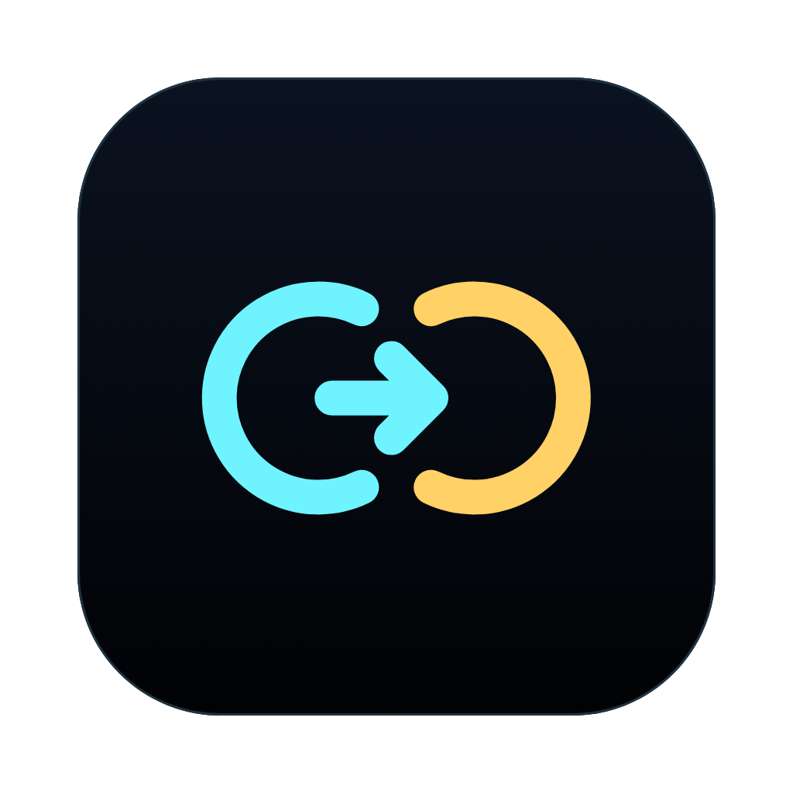
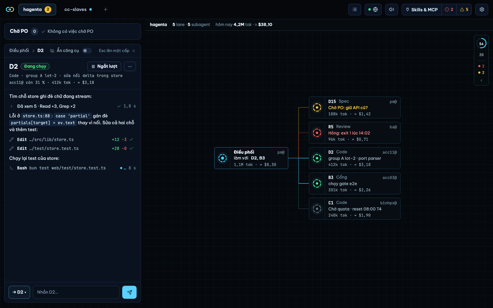
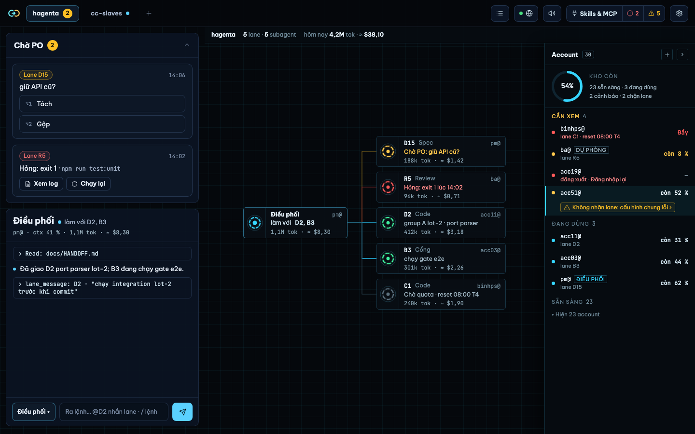
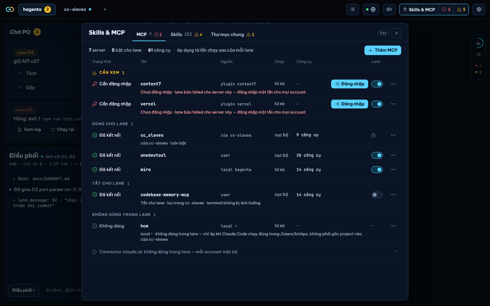

<div align="center">



# cc-slaves

**A command deck for Claude Code on macOS.**
You make the calls; dozens of parallel `claude` sessions do the rest.

[Tiếng Việt](README.md) · **English**

[](https://github.com/billphamhypertek/cc-slaves/releases/latest)
[](#install)
[](LICENSE)



</div>

---

## What is cc-slaves?

cc-slaves is a macOS app for running many Claude Code sessions at once. Each project has one **orchestrator** session:
you hand it the work, it splits the work into **lanes**, and each lane is a headless `claude` session in its own git
worktree. Lanes move through Spec → Code → Review → Gate → Merge; you only step in when something really needs you.

If you have several Claude accounts, cc-slaves picks an account with quota left for each lane. When one account hits its
cap, the lane carries on with another.

> [!NOTE]
> This is a personal tool, built for exactly one user and shared as is. There is no cloud version and no multi-user
> support.

> The UI ships in Vietnamese and English (switch in Settings). The screenshots below show the Vietnamese UI.

## Features

- **Hitting a quota cap doesn't stop the work.** When one account is capped, the lane resumes on another account with
  quota left, in the same session.
- **It only calls you when it has to.** Lanes with a question or a failure show up in the *PO inbox* column; answer
  with one key.
- **See the whole team at a glance.** A live graph of orchestrator → lanes → subagents, with tokens and cost.
- **Install an MCP once, every account uses it.** Skills and MCP servers are shared by all accounts; sign in to an MCP
  once and every lane has it.
- **Local only.** The engine runs in the background on your Mac and keeps its data in `~/.cc-slaves/`. cc-slaves calls the
  Claude Code CLI directly, with no service in between. Apart from Claude, the app only asks this repo's Releases page
  whether a new version is out.

<table>
  <tr>
    <td width="50%"></td>
    <td width="50%"></td>
  </tr>
  <tr>
    <td align="center"><sub>Account panel: the shared quota pool and the accounts that need a look</sub></td>
    <td align="center"><sub>Skills &amp; MCP: managed in one place, shared by every account</sub></td>
  </tr>
</table>

## Requirements

| | |
|---|---|
| Hardware | Apple Silicon Mac (M1 or later) |
| OS | macOS 13 Ventura or later |
| Claude Code CLI | Installed, `claude` works in Terminal ([setup guide](https://docs.anthropic.com/en/docs/claude-code/setup)) |
| Account | At least one Claude plan (Pro/Max). More accounts let quota switching do more |

## Install

1. **Download the latest build** from [Releases](https://github.com/billphamhypertek/cc-slaves/releases/latest) and unzip
   it to get `cc-slaves.app`.
2. **Drag `cc-slaves.app` into `Applications`.**
3. **Remove the macOS quarantine flag.** Open Terminal and run:

   ```bash
   xattr -d com.apple.quarantine /Applications/cc-slaves.app
   ```

   If you put the app somewhere else, adjust the path. Tip: type `xattr -d com.apple.quarantine ` (with a trailing space),
   then drag the app from Finder into the Terminal window to paste its path.
4. **Open cc-slaves.** On first launch a setup wizard checks the Claude Code CLI, signs in your Claude accounts
   (cc-slaves runs `claude auth login` for each one) and sets each account's role and caps.

### Why the `xattr` command?

cc-slaves is only ad-hoc signed and not notarized by Apple. macOS tags files downloaded through a browser with
`com.apple.quarantine`, so Gatekeeper blocks the app with *"cc-slaves.app is damaged and can't be opened"* or *"Apple could
not verify…"*. The app is not damaged: the command only removes that flag so macOS lets it run.

> [!WARNING]
> Only remove the flag from builds downloaded from this repository's official Releases page. `xattr` skips the
> Gatekeeper check for that app; don't use it on apps you don't trust.

<details>
<summary><b>Still won't open?</b></summary>

- Check whether the flag is still there: `xattr -l /Applications/cc-slaves.app`. If `com.apple.quarantine` is still
  listed, run the recursive form to clear the files inside the bundle too:

  ```bash
  xattr -dr com.apple.quarantine /Applications/cc-slaves.app
  ```

- If you download a new build yourself and install it over the old one, macOS tags that build again. Run the `xattr`
  command once more.
- `claude: command not found`: install the Claude Code CLI first, open a new Terminal and try `claude --version`.

</details>

## Update

From 0.3.0 on, cc-slaves updates itself, so the manual install above is a one-time step. The app checks for a new
release when it opens and every few hours. When one is out, the top bar shows a **New 0.3.x** button: click it to see
what changed, then click **Update**. Lanes that are mid-turn finish that turn first; then the app installs the update and
reopens. You can also check at any time in **Settings → Engine**.

Updates are signed, and the app verifies the signature before installing. Your data in `~/.cc-slaves/` and accounts in
`~/.cc-slaves-accounts/` are kept. Because the app is only ad-hoc signed, macOS may ask for privacy permissions again
(for example folder access) after each new version; just allow them again.

## Uninstall

```bash
launchctl bootout gui/$(id -u)/com.ccslaves.app.engine 2>/dev/null
launchctl bootout gui/$(id -u)/com.ccslaves.app.menubar 2>/dev/null
rm -f ~/Library/LaunchAgents/com.ccslaves.app.*.plist
rm -rf /Applications/cc-slaves.app
```

To also delete the data and the accounts signed in through cc-slaves: `rm -rf ~/.cc-slaves ~/.cc-slaves-accounts`.
Claude Code's own `~/.claude` folder is left untouched.

## How it works

```
cc-slaves.app (Tauri)  ──►  background engine (LaunchAgent)  ──►  claude -p … (one session + one worktree per lane)
      │                            │
      └── web UI                   └── picks an account with quota, switches at the cap, resumes the session
```

- **Engine** is TypeScript compiled with Bun and runs as a LaunchAgent, so lanes keep running when the window is closed.
- **Each lane** is a headless `claude` session (`-p`, stream-json) in its own git worktree.
- **Menu-bar icon** lives with the engine: a coloured dot shows its state; click it to see the running lanes.

## Development

Requires Node 24, Bun and Rust.

```bash
bun install
bun run app:dev      # run the app in development mode
bun run typecheck && bun run test
bun run app:build    # package cc-slaves.app (ad-hoc signed)
```

## License

[GNU AGPL-3.0](LICENSE) © 2026 billphamhypertek. You may use, modify and redistribute it; if you distribute a modified version, or let others use a modified version over a network, you must publish its source under the same license. Releases before 18 Nov 2026 remain under MIT.

cc-slaves is not affiliated with Anthropic. Claude and Claude Code are trademarks of Anthropic.
