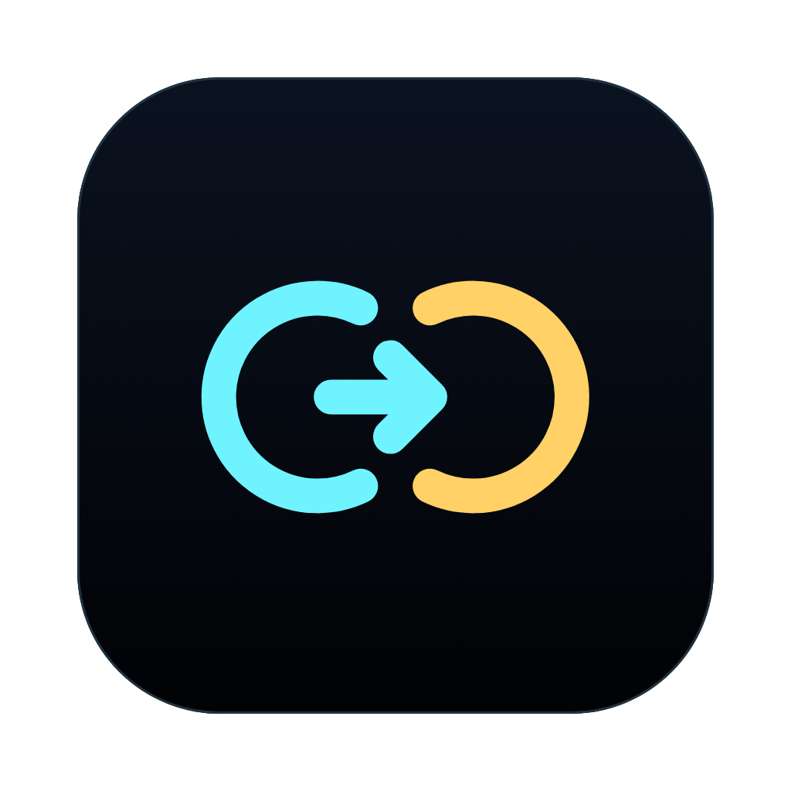
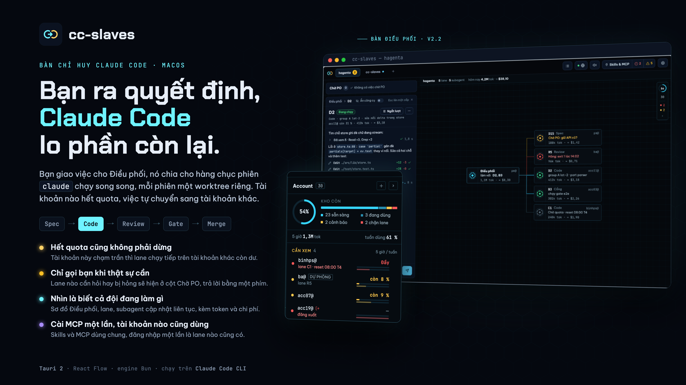
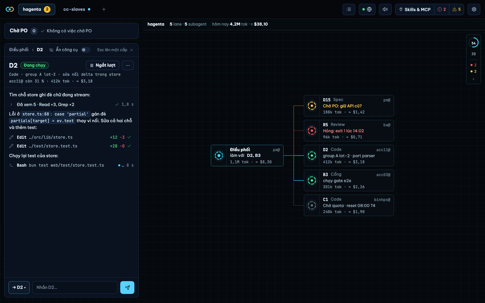
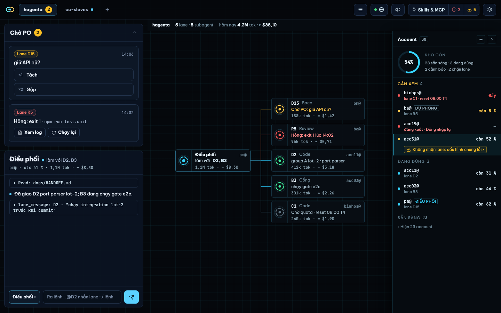
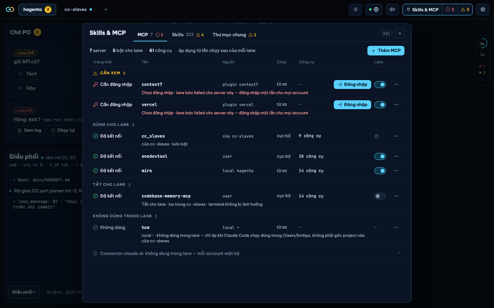

<div align="center">



# cc-slaves

**Bàn chỉ huy Claude Code trên macOS.**
Bạn ra quyết định, hàng chục phiên `claude` chạy song song lo phần còn lại.

**Tiếng Việt** · [English](README.en.md)

[](https://github.com/billphamhypertek/cc-slaves/releases/latest)
[](#cài-đặt)
[](LICENSE)



</div>

---

## cc-slaves là gì?

cc-slaves là app macOS để điều khiển nhiều phiên Claude Code cùng lúc. Mỗi project có một phiên **Điều phối**: bạn giao
việc cho nó, nó chia việc thành các **lane**, mỗi lane là một phiên `claude` chạy nền trong git worktree riêng. Lane đi
qua các bước Spec → Code → Review → Gate → Merge, còn bạn chỉ phải trả lời khi có việc thật sự cần bạn.

Nếu bạn có nhiều tài khoản Claude, cc-slaves chọn tài khoản còn quota cho từng lane. Tài khoản nào chạm trần thì lane chạy
tiếp trên tài khoản khác.

> [!NOTE]
> Đây là công cụ cá nhân, viết cho đúng một người dùng và chia sẻ nguyên trạng. Không có bản cloud, không có tài khoản
> nhiều người dùng.

## Tính năng

- **Hết quota cũng không phải dừng.** Tài khoản này chạm trần thì lane chạy tiếp trên tài khoản khác còn dư, giữ nguyên
  phiên làm việc.
- **Chỉ gọi bạn khi thật sự cần.** Lane nào cần hỏi hay bị hỏng sẽ hiện ở cột *Chờ PO*, trả lời bằng một phím.
- **Nhìn là biết cả đội đang làm gì.** Sơ đồ Điều phối → lane → subagent cập nhật liên tục, kèm token và chi phí.
- **Cài MCP một lần, tài khoản nào cũng dùng.** Skills và MCP dùng chung cho mọi tài khoản, đăng nhập MCP một lần là lane
  nào cũng có.
- **Chạy cục bộ.** Engine chạy nền trên máy bạn, dữ liệu nằm trong `~/.cc-slaves/`. cc-slaves gọi thẳng Claude Code CLI,
  không đi qua dịch vụ trung gian nào. Ngoài Claude, app chỉ hỏi trang Releases của repo này để biết có bản mới không.

<table>
  <tr>
    <td width="50%"></td>
    <td width="50%"></td>
  </tr>
  <tr>
    <td align="center"><sub>Sơ đồ lane, bên trái là luồng làm việc của lane đang xem</sub></td>
    <td align="center"><sub>Bảng Account: kho quota chung và tài khoản cần xem</sub></td>
  </tr>
  <tr>
    <td colspan="2"></td>
  </tr>
  <tr>
    <td colspan="2" align="center"><sub>Skills &amp; MCP: một chỗ quản lý, mọi tài khoản dùng chung</sub></td>
  </tr>
</table>

## Yêu cầu

| | |
|---|---|
| Máy | Mac chip Apple Silicon (M1 trở lên) |
| Hệ điều hành | macOS 13 Ventura trở lên |
| Claude Code CLI | Đã cài và gõ được `claude` trong Terminal ([hướng dẫn cài](https://docs.anthropic.com/en/docs/claude-code/setup)) |
| Tài khoản | Ít nhất một gói Claude (Pro/Max). Có nhiều tài khoản thì càng tận dụng được tính năng chuyển quota |

## Cài đặt

1. **Tải bản mới nhất** ở trang [Releases](https://github.com/billphamhypertek/cc-slaves/releases/latest), giải nén
   ra `cc-slaves.app`.
2. **Kéo `cc-slaves.app` vào thư mục `Applications`.**
3. **Gỡ cờ cách ly của macOS.** Mở Terminal và chạy:

   ```bash
   xattr -d com.apple.quarantine /Applications/cc-slaves.app
   ```

   Nếu bạn để app ở chỗ khác, thay đường dẫn cho đúng. Mẹo: gõ `xattr -d com.apple.quarantine ` (có dấu cách cuối), rồi
   kéo app từ Finder thả vào cửa sổ Terminal để điền sẵn đường dẫn.
4. **Mở cc-slaves.** Lần đầu, trình hướng dẫn kiểm tra Claude Code CLI, giúp bạn đăng nhập tài khoản Claude (cc-slaves gọi
   `claude auth login` cho từng tài khoản) và đặt vai trò, mức trần cho từng tài khoản.

### Vì sao cần lệnh `xattr`?

cc-slaves chỉ được ký ad-hoc, chưa qua notarization của Apple. File tải từ trình duyệt bị macOS gắn cờ
`com.apple.quarantine`, nên Gatekeeper chặn app và báo *"cc-slaves.app is damaged and can't be opened"* hoặc *"Apple could
not verify…"*. App không hỏng: lệnh trên chỉ gỡ cờ đó để macOS cho chạy.

> [!WARNING]
> Chỉ gỡ cờ cho bản tải từ trang Releases chính thức của repo này. Lệnh `xattr` tắt bước kiểm tra của Gatekeeper cho
> đúng app đó, đừng dùng nó cho app không rõ nguồn.

<details>
<summary><b>Vẫn không mở được?</b></summary>

- Kiểm tra cờ còn không: `xattr -l /Applications/cc-slaves.app`. Nếu còn thấy `com.apple.quarantine`, chạy lại lệnh gỡ
  với cờ đệ quy để gỡ cả các file bên trong bundle:

  ```bash
  xattr -dr com.apple.quarantine /Applications/cc-slaves.app
  ```

- Nếu bạn tự tải bản mới về cài đè, macOS sẽ gắn cờ lại cho bản đó. Chạy lại lệnh `xattr` là xong.
- Báo `claude: command not found`: cài Claude Code CLI trước, mở Terminal mới và thử `claude --version`.

</details>

## Cập nhật

Từ bản 0.3.0, cc-slaves tự cập nhật, nên bạn chỉ phải cài tay đúng một lần như trên. App tự kiểm tra bản mới lúc mở và vài
giờ một lần. Khi có bản mới, thanh trên hiện nút **Bản mới**: bấm vào để xem có gì mới rồi bấm **Cập nhật**. Lane nào đang
chạy dở sẽ được làm xong lượt của nó trước, sau đó app tự cài và mở lại. Bạn cũng có thể kiểm tra bất cứ lúc nào trong
**Cài đặt → Engine**.

Bản cập nhật được ký và app kiểm chữ ký trước khi cài. Dữ liệu trong `~/.cc-slaves/` và tài khoản trong
`~/.cc-slaves-accounts/` được giữ nguyên. Vì app chỉ được ký ad-hoc, sau mỗi bản mới macOS có thể hỏi lại các quyền riêng tư
(ví dụ quyền truy cập thư mục); cứ cho phép lại như lần đầu.

## Gỡ cài đặt

```bash
launchctl bootout gui/$(id -u)/com.ccslaves.app.engine 2>/dev/null
launchctl bootout gui/$(id -u)/com.ccslaves.app.menubar 2>/dev/null
rm -f ~/Library/LaunchAgents/com.ccslaves.app.*.plist
rm -rf /Applications/cc-slaves.app
```

Muốn xóa luôn dữ liệu và các tài khoản đã đăng nhập trong cc-slaves: `rm -rf ~/.cc-slaves ~/.cc-slaves-accounts`.
Thư mục `~/.claude` của Claude Code không bị đụng tới.

## Cách hoạt động

```
cc-slaves.app (Tauri)  ──►  engine chạy nền (LaunchAgent)  ──►  claude -p … (mỗi lane một phiên, một worktree)
      │                            │
      └── giao diện web            └── chọn tài khoản còn quota, chuyển tài khoản khi chạm trần, resume phiên
```

- **Engine** viết bằng TypeScript, đóng gói bằng Bun, chạy nền như LaunchAgent nên lane vẫn chạy khi đóng cửa sổ.
- **Mỗi lane** là một phiên `claude` headless (`-p`, stream-json) trong git worktree riêng.
- **Biểu tượng trên thanh menu** chạy cùng engine: chấm màu báo trạng thái, bấm vào để xem các lane đang chạy.

## Phát triển

Cần Node 24, Bun và Rust.

```bash
bun install
bun run app:dev      # chạy app ở chế độ phát triển
bun run typecheck && bun run test
bun run app:build    # đóng gói cc-slaves.app (ký ad-hoc)
```

## Giấy phép

[GNU AGPL-3.0](LICENSE) © 2026 billphamhypertek. Bạn được dùng, sửa và phát hành lại; nếu phát hành bản đã sửa, hoặc cho người khác dùng bản đã sửa qua mạng, thì phải công bố mã nguồn của bản đó theo cùng giấy phép. Các bản phát hành trước 18/11/2026 vẫn theo giấy phép MIT.

cc-slaves không liên kết với Anthropic. Claude và Claude Code là thương hiệu của Anthropic.
